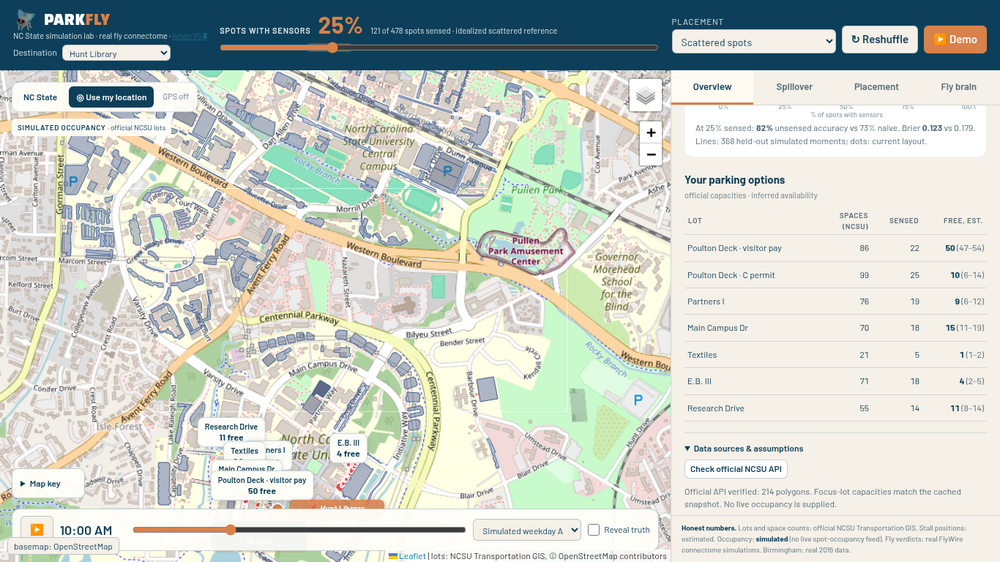

# 🪰 ParkFly — a real fly brain in a parking simulation

**[Open the simulation lab](https://parkfly-one.vercel.app)** · **[Open FlyBrain](https://parkfly-one.vercel.app/?connect=1)**

ParkFly converts sparse parking observations into sensory inputs for a real fruit-fly connectome. It asks: how does a fixed biological circuit act when its view of the environment is uncertain, and how much does calibrating the input encoding improve its decisions?



## What runs

1. A seeded driver simulator generates hidden occupancy on official NC State parking geometry, with **478 estimated spot positions** across **7 modeled permit sections**. Spot locations are estimates; capacities come from NCSU.
2. A Bayesian fill-frontier model observes a chosen percentage of spots and predicts occupancy probabilities for the remainder. Changing sensor coverage, placement or simulated time updates the map.
3. The posterior becomes three inputs: **sugar** (available parking and a short trip), **bitter** (uncertainty, permit risk and price), **looming** (rising fill and near-full posterior mass).
4. A leaky integrate-and-fire simulation of the signed **FlyWire/Shiu v783** connectome supplies real measured responses. **MN9** means commit, **MDN** means back off, and **Giant Fibre / DNp01** means divert.
5. The browser interpolates a saved response surface for fast interaction. The network view aggregates actual signed synapse counts; the raster is labeled recorded playback. A Giant-Fibre **input** lesion zeros its incoming columns and changes a reproducible simulation scene.

## The brain and the training algorithm

The numerical simulator matches the uploaded **NC STATE Fly Brain Starter**: NumPy voltage/spike arrays, a SciPy sparse CSR matrix `W[pre, post]`, pandas annotation tables, and the signed `Connectivity_783.parquet` file.

| Brain quantity | Value | Meaning |
|---|---:|---|
| Neurons | 138,639 | Rows in the real v783 neuron table |
| Nonzero neuron-to-neuron connections | 15,091,983 | Sparse matrix entries with signed synapse-count weights |
| Input combinations | 80 | 5 sugar × 4 bitter × 4 looming levels |
| Brain conditions | 2 | Intact and GF-input-lesioned |
| Fixed seeds per combination | 3 | Repeated Poisson input realizations |
| Saved full-brain runs | 480 | 80 × 2 × 3 |
| Time per run | 200 ms | Starts from rest, at a 0.1 ms step |
| Sanity checks | 6 passed | Silence, sugar, bitter suppression, looming escape, input lesion, and decay after input stops |

**The connectome wiring is fixed.** Training calibrates the parking-to-sense encoder. It does not train or rewrite the fly's synapses.

`pipeline/calibrate_fly.py` regenerates **14 simulated training weekdays (seeds 100–113)**, then evaluates **81 encoder configurations** at observation coverages 0%, 10%, 25% and 50%. The objective first maximizes training decisions that find a free spot, then minimizes walking plus a five-minute full-lot penalty. It selects the encoder before evaluating any test outcomes.

The selected parameters are:

| Parameter | Selected value | Role |
|---|---:|---|
| Walk scale | 2.0 min | Discounts sugar for a long trip |
| Uncertainty gain | 0.5 | Scales posterior uncertainty in bitter |
| Fill-rise gain | 0.5 | Scales rising fill in looming |
| Near-full gain | 1.0 | Adds posterior mass above 95% fill to looming |

The calibrated sugar input averages availability over the posterior before applying the trip discount. This retains uncertainty that is lost when availability is computed only from the mean free count. The same encoder math runs in Python and JavaScript, with numerical parity tests.

## Measured decision accuracy

The final evaluation uses **four other simulated weekdays (seeds 1–4)**. At each sensor coverage, **156 test cases** span arrival times from 07:30 through 17:00. All policies receive the same sensor masks and candidate lots. The score asks whether the chosen lot has a free spot at that simulated snapshot. Times below are **walking + a five-minute failure penalty**, not measured driving time.

At **25% observed spots**:

| Policy | Free-spot success | Mean cost, min |
|---|---:|---:|
| Calibrated encoder + intact brain | 96.79% (151/156) | 1.583 |
| Original encoder + intact brain | 96.15% (150/156) | 1.763 |
| Calibrated encoder + GF input lesion | 96.79% (151/156) | 1.567 |
| Nearest lot | 96.15% (150/156) | 1.599 |
| Direct sensory score | 96.15% (150/156) | 1.771 |
| Oracle with the simulated true state | 98.72% (154/156) | 1.471 |

Calibration improved the result by **0.64 percentage points**, which is **one additional successful case out of 156**. The 95% paired interval is **0.00 to 1.92 percentage points**, obtained by resampling whole test days 2,000 times. This interval includes zero; four simulated days do not establish a reliable real-world improvement.

The calibrated lesioned brain ties the intact one at 25% in this aggregate evaluation. A selected lesion scene still demonstrates a real change in readout/behavior. That scene is presented separately from the unbiased test curve.

## Occupancy inference results

These measure the parking posterior, while the decision table above measures the brain-based policy. All spot scores exclude observed spots.

| Metric at 25% observed | Fill model | Naive observed-share baseline |
|---|---:|---:|
| Unsensed-spot accuracy | 81.88% | 72.87% |
| Brier error | 0.1232 | 0.1789 |
| Log loss | 0.3774 | 0.5331 |
| Brier with simulated across-lot conditioning | 0.1226 | 0.1789 |

Brier is the mean squared error of occupancy probabilities; lower is better. Accuracy thresholds probabilities at 0.5. The dashboard's live values describe the selected day, time and mask; the table averages held-out moments. At 100% coverage there are no unobserved targets, so unsensed accuracy and Brier display **n/a**.

Across-lot inference also has a real-data check: **28 Birmingham UK car parks**, **51 chronological training days / 22 later test days**. Sensing 25% reduces matched hidden-lot occupancy MAE from **0.0702 to 0.0473**, a **32.5% reduction**; sensor-draw SD is **0.0055** over 200 masks. This is an across-lot inference result on 2016 observations. Birmingham has no coordinates, so covariance is empirical.

## Reproduce the model

```sh
python3 -m venv .venv
.venv/bin/pip install -r requirements.txt
.venv/bin/python build_ncstate.py
.venv/bin/python pipeline/birmingham_validate.py
.venv/bin/python -m pytest -q
node --test tests/parity.test.mjs
python3 -m http.server 8765 -d web
```

Open http://localhost:8765. Model fitting and evaluation run locally; the map works offline with cached geometry and a plain polygon fallback.

**Full-brain Colab:** [colab/fly_surface.ipynb](colab/fly_surface.ipynb). The simulation downloads the three public tables without a FlyWire token. The optional skeleton cell uses the starter's **FAFBseg 3.2.3, Navis 1.12.0, Plotly and crackle-codec**; only that visualization needs a private token. [requirements-visualization.txt](requirements-visualization.txt) keeps these optional dependencies separate. The PDF's missing-CAVE-secret error belongs to skeleton access and does not block the public-table simulation. No token is included in this repository.

```sh
.venv/bin/python pipeline/fly_surface.py sanity
.venv/bin/python pipeline/fly_surface.py surface --workers 2 --seeds 3
.venv/bin/python pipeline/fly_surface.py raster
.venv/bin/python pipeline/export_fly_network.py
```

Browser verification: run the local server, then `npm ci && npm run test:browser`. Tests use mocked GPS positions, including permission denial and Stop; the user's physical location is never accessed by the tests.

## Connections and deployment

Production: **https://parkfly-one.vercel.app**, project **`monica-a634/parkfly`**. The Vercel project root is **`web`**. Deploy from the repository root:

```sh
vercel deploy --prod --yes --scope monica-a634
```

The official NCSU geometry/capacity proxy is `/api/ncsu`. It supplies no live per-spot occupancy. Connecting device GPS updates estimated travel costs into the encoder after browser permission; ParkFly keeps coordinates in page memory, and basemap providers receive viewed-area tile requests. Drive time uses an explicitly labeled distance/speed approximation.

A previous automatic Git build used the repository root and produced a 404. The Vercel root setting is now `web`, and the production alias was restored. GitHub write authentication is separate from Vercel: local commits preserve all work, while remote publication must be verified against `origin/main` before claiming a successful push.

Agent setup: CLI 65.16.0 authenticated as `momacaes9`; official Vercel skills installed globally for Codex. Shared MCP endpoint configured at `https://mcp.vercel.com`; MCP OAuth remains incomplete, so authenticated MCP tool access is not claimed. See [VERCEL_SETUP.md](VERCEL_SETUP.md).

## Present the experiment

[Open the demo guide](https://parkfly-one.vercel.app/lab/demo.html): a six-minute live script with four- and five-minute cuts, a recorded-video script, judge Q&A, a number card, and presentation support. Spoken text is English; staging instructions are Portuguese. The guide uses the measured exports and explicitly distinguishes encoder calibration from fixed biological wiring.

## Limits and sources

Parking occupancy, driver behavior, entrances, travel cost and permit simplifications are simulation assumptions. Spot positions are estimated; NCSU capacity/geometry is official. Browser output comes from a measured spiking-response table. Calibration is evaluated on four simulated test days and does not demonstrate deployment accuracy at a real campus. The recorded raster is a canonical example rather than a live full-brain computation.

FlyWire; Shiu et al. 2024, Nature, doi:10.1038/s41586-024-07763-9; NCSU Transportation GIS; OpenStreetMap contributors (ODbL); Birmingham UCI #482, Stolfi 2017, doi:10.24432/C51K5Z; the NC State Fly Brain Starter notebook. Geometric estimation/data-loading methods were adapted from [momacaes9/parkshark](https://github.com/momacaes9/parkshark). Vendor licenses and font OFL files are retained. No AI-generated images.

## Ishan V6 collaboration

Integrated upstream `V6` at `47dab17` alongside this lab. [Open V6 campus simulation](https://parkfly-one.vercel.app/v6/). Its source remains in `parkshark_fly_ncstatev6/`, with published assets in `web/v6/`. Both views use the same Vercel project and production domain. V6 has its own imported neural exports and modeled campus demand; the lab accuracy results above do not validate the V6 scenario. Changing the hour away from the recorded 10am run switches to a clearly labeled heuristic, as do changed preferences or destinations.

## Latest integrated results — 14 November 2026

Both app views are hosted by **one Vercel project, `monica-a634/parkfly`**, with root directory `web`:

- **Validated simulation lab:** https://parkfly-one.vercel.app
- **Ishan V6 campus simulation:** https://parkfly-one.vercel.app/v6/
- **Live/video demo and judge Q&A:** https://parkfly-one.vercel.app/lab/demo.html

| Latest result | Number | How to read it |
|---|---:|---|
| Real fly graph | 138,639 neurons; 15,091,983 nonzero connections | Biological connectivity used by the fixed spiking simulator; connections are neuron-pair matrix entries, not a count of individual synapses |
| Saved brain experiment | 480 runs | 80 sensory combinations × 2 brain conditions × 3 seeds; browser interpolates these measured outputs |
| Encoder calibration | 81 candidates, 14 training days | Optimizes sensory encoding; biological synapses remain fixed |
| Brain-policy success at 25% sensing | 151/156 = 96.79% | Four held-out simulated days; original encoder succeeds in 150/156 = 96.15% |
| Calibration gain | +0.64 percentage points | One extra case; 95% whole-day bootstrap interval 0–1.92 pp includes zero |
| Unsensed-spot inference | 81.88% versus 72.87% | Different task: predicts hidden spot occupancy, rather than whether a selected lot has a free spot |
| Probability error | Brier 0.1232 versus 0.1789 | Lower is better; evaluated only on unobserved spots |
| Birmingham validation | 28 car parks; 51 train / 22 test days | Real historical occupancy, separate from the NC State simulation |
| Birmingham hidden-lot MAE | 0.0702 → 0.0473 | About 32.5% lower error at 25% sensing, over 200 sensor masks |
| V6 campus coverage | 144 lots; 17,527 official capacity spaces | Counts computed from V6 embedded DATA_BLOB, not the 478-spot lab scenario |
| V6 detail views | 75 estimated layouts; 9 destinations | Layouts and occupancy are simulated; official capacity does not make a layout a measured floor plan |
| V6 imported brain export | 14 scored lots; 3 fly journeys | Recorded weekday 10am scenario. Other hours/destinations/preferences use labeled heuristic scores |

**Library use:** NumPy integrates membrane potentials and seeded Poisson inputs; SciPy stores and propagates the sparse connectome; pandas/PyArrow load and join neuronal annotations and connectivity; Leaflet displays official NC State geometry. FAFBseg/Navis/Plotly are optional skeleton-visualization dependencies. Flybody is not part of this implementation.

**Live connection:** `/api/ncsu` retrieves official parking geometry and capacities (214 source features). Browser-approved GPS changes estimated travel inputs locally. Neither supplies live parking occupancy. These results support a reproducible simulation demonstration; they are not measured campus deployment accuracy.
